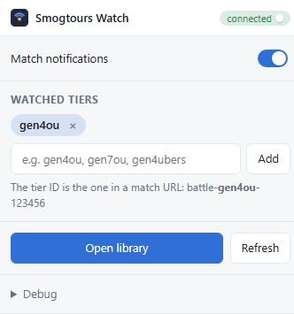
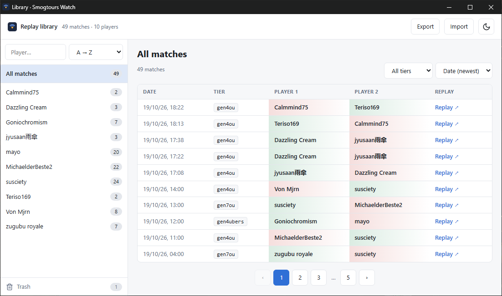

# Smogtours Watch

A Chrome extension for [smogtours](https://smogtours.psim.us), Smogon's Pokémon Showdown tournament server. It tells you when a match starts in the tiers you follow, saves the replay automatically when the match ends, and keeps a library of every replay, organized by player.

> Not affiliated with Smogon or Pokémon Showdown.




## Features

- **Match alerts**: a silent desktop notification when a match starts in one of your tiers (e.g. `gen4ou`). Click it to watch the match live.
- **Automatic replays**: when a match ends, its replay is fetched and saved. If the replay is not online yet, the extension retries for about 9 minutes.
- **Replay library**: every match, listed by player, with win/loss record, tier filter, sorting and pagination. Click any player to see their matches.
- **Trash**: delete matches you don't want and restore them while the library is open. The trash is emptied when you close the library.
- **Export / import**: back up the whole library as a JSON file and load it again later or on another computer.
- **Pause**: click the status pill in the popup to stop monitoring entirely, then click it again to resume.
- **Light and dark themes.**

Only smogtours matches are tracked, never matches from the main Showdown server.

## Installation

The extension is not on the Chrome Web Store, so you load it manually. All you need is Chrome 116 or later.

1. Download `smogtours-watch.zip` from the latest [release](https://github.com/<your-username>/smogtours-watch/releases/latest).
2. Unzip it to a folder you will keep. Chrome loads the extension from this folder, so don't delete or move it afterwards.
3. Open `chrome://extensions` in Chrome.
4. Turn on **Developer mode** (top right).
5. Click **Load unpacked** and select the unzipped folder (the one that contains `manifest.json`).
6. Pin the extension to the toolbar to reach the popup easily.

**To update:** download the new zip, unzip it over the same folder, then click the reload button on the extension's card in `chrome://extensions`. Your library and settings are kept.

### Build from source

To build the extension yourself or change the code, you also need [Node.js](https://nodejs.org) 20 or later.

```sh
git clone https://github.com/<your-username>/smogtours-watch.git
cd smogtours-watch
npm install
npm run build
```

Then follow steps 3 to 6 above and select the `dist` folder.

## Usage

1. Click the extension icon to open the popup.
2. Under **Watched tiers**, add the tiers you want to follow. The tier ID is the one in a match URL: `battle-`**`gen4ou`**`-123456`.
3. The status pill shows `connected` (green) when monitoring is running, or `offline` (red) otherwise. Click it to pause or resume monitoring.
4. Click **Open library** to browse saved replays.

## How it works

- The extension connects as a guest to the smogtours server (`wss://sim3.psim.us:8001/showdown/websocket`). No account is needed.
- Every 10 seconds it asks the server for the list of current battles in your tiers. A battle that appears is a new match, and a battle that disappears has ended.
- When a match ends, the replay is fetched from `replay.pokemonshowdown.com`. All smogtours matches are public and their replays are saved by the server.
- Everything is stored locally in your browser (IndexedDB and `chrome.storage`). Nothing is sent anywhere else.

## Development

```sh
npm install
npm run dev        # rebuilds dist/ on every save
npm run build      # type-checks, then builds dist/
npm run typecheck  # type-check only
```

After each rebuild, click reload on the extension's card in `chrome://extensions`.

Stack: React 19, TypeScript, Vite with [CRXJS](https://crxjs.dev), Manifest V3.

```
src/
  background.ts   service worker: connection, polling, notifications, replays
  lib/            Showdown protocol, IndexedDB, shared types
  shared/         settings and chrome.storage hooks
  popup/          popup components
  library/        library components and logic (data.ts)
  ui.css          all styles, colors and font sizes as CSS variables
public/           icons and theme.js
```

## License

[MIT](LICENSE)
